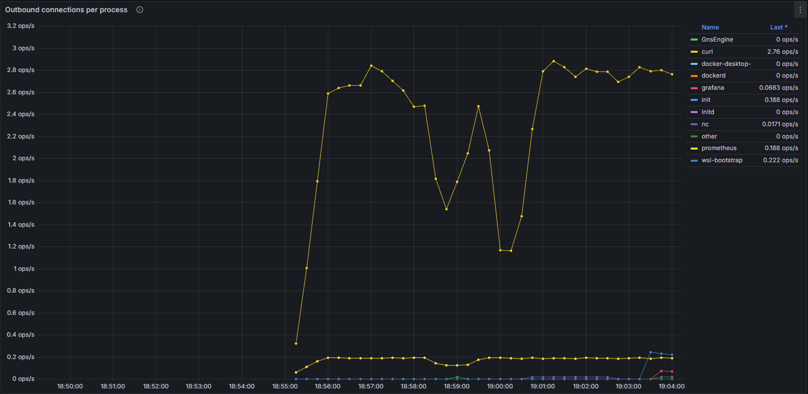
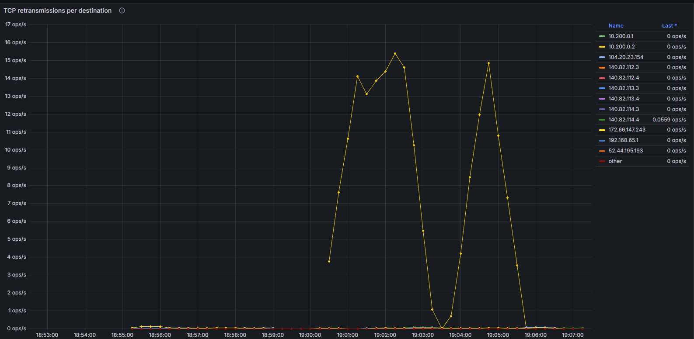
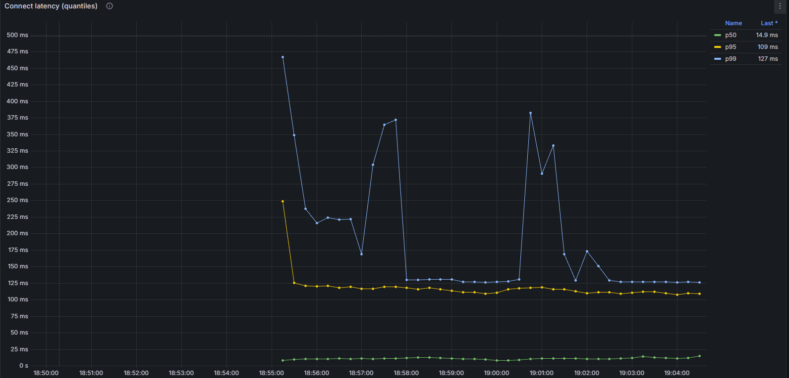
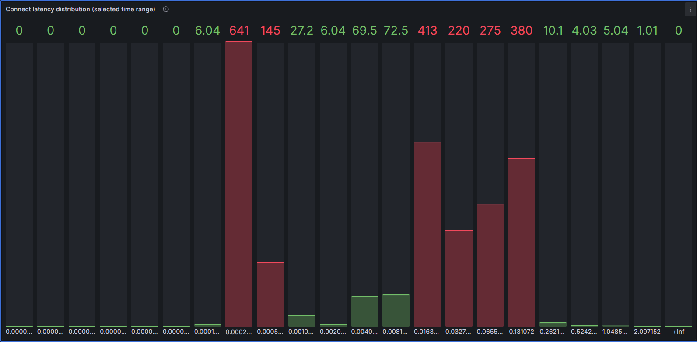
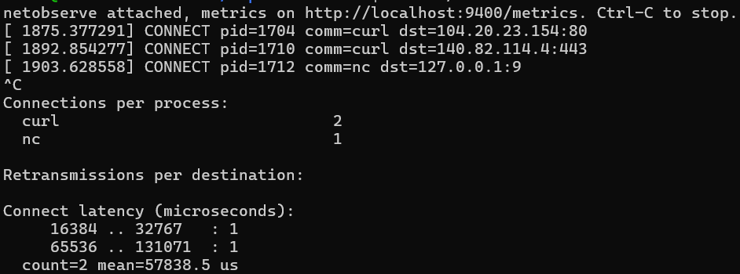
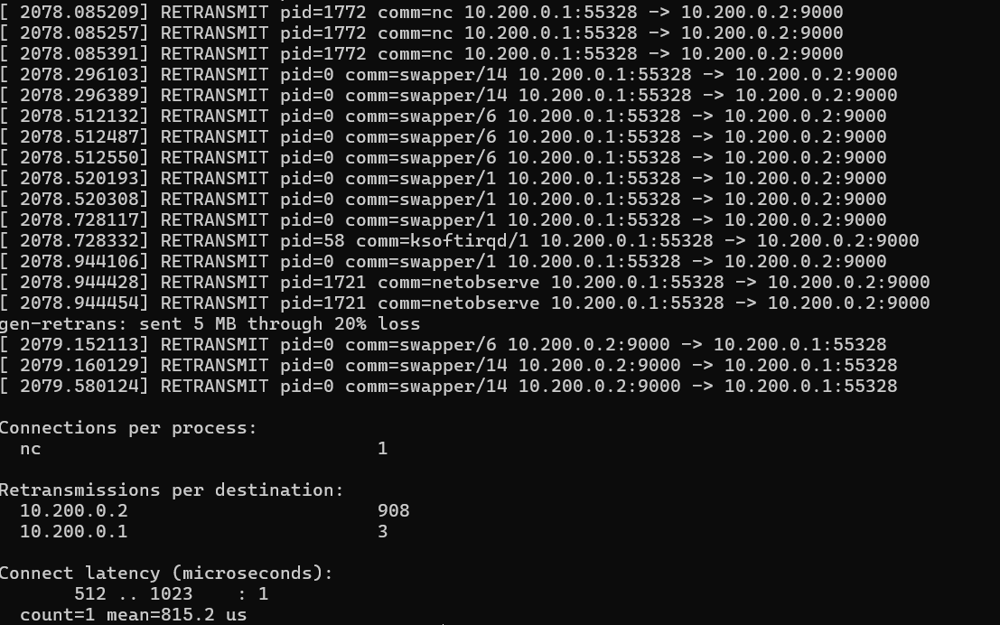
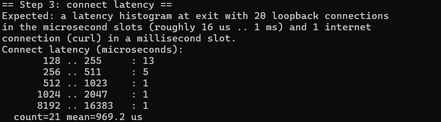
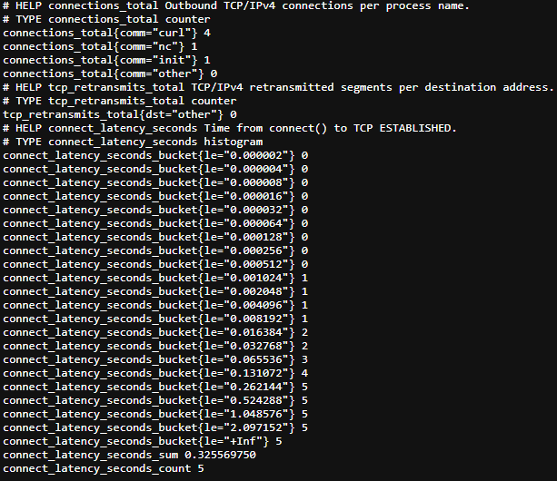
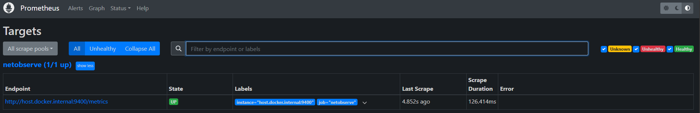
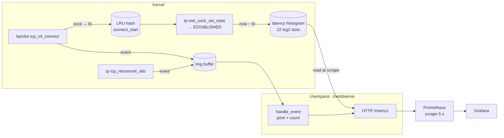

<div align="center">

# ebpf-netobserve

**See every TCP connection your machine makes, from inside the kernel.**

Per-process outbound connections · TCP retransmissions · connect latency histograms
→ Prometheus `/metrics` → Grafana. Written in plain C with libbpf (CO-RE). No agent, no sidecar, no code change in the observed apps.


</div>

<table>
  <tr>
    <td align="center"><br>
      <sub>Connections/s per process (curl, prometheus, grafana, dockerd…)</sub></td>
    <td align="center"><br>
      <sub>Retransmissions/s per destination: each spike is one <code>gen-retrans.sh</code> run (20 % loss)</sub></td>
  </tr>
  <tr>
    <td align="center"><br>
      <sub>p50 / p95 / p99 handshake latency</sub></td>
    <td align="center"><br>
      <sub>Latency distribution: loopback (~0.2 ms) vs internet (~15–130 ms)</sub></td>
  </tr>
</table>
<p align="center"><sub>Real data captured on WSL2, kernel 6.18, with the provisioned Grafana dashboard.</sub></p>

---

## Contents

- [Why](#why)
- [What it shows](#what-it-shows)
- [Quick start](#quick-start)
- [Full demo with Prometheus and Grafana](#full-demo-with-prometheus-and-grafana)
- [How it works](#how-it-works)
- [Metrics reference](#metrics-reference)
- [Overhead benchmark](#overhead-benchmark)
- [Project layout](#project-layout)
- [Limitations](#limitations)
- [Roadmap](#roadmap)

## Why

"Which process is opening all these connections?", "Is the network dropping
packets?", "Why is connecting to the database slow?" are usually answered with
`tcpdump`, `ss` in a loop, or by instrumenting the application.

eBPF answers them **from the kernel**, for **every process at once**, with a
cost of a few hundred nanoseconds per connection. This project is a small,
readable implementation of that idea: ~1 kernel file, ~5 userspace files, no
framework.

## What it shows

| Signal | Kernel hook | Answers |
|---|---|---|
| Outbound connections per process | `kprobe/tcp_v4_connect` | *who* talks to *whom* |
| TCP retransmissions per destination | `tracepoint/tcp/tcp_retransmit_skb` | *where* packets get lost |
| Connect latency (connect() → ESTABLISHED) | `kprobe` + `tracepoint/sock/inet_sock_set_state` | *how long* the handshake takes |

### Live events in the terminal



### Retransmissions under 20 % packet loss



### Latency histogram computed in the kernel



### Prometheus endpoint



## Quick start

**Requirements:** Linux kernel with BTF (`ls /sys/kernel/btf/vmlinux`), root
to load BPF programs.

```sh
# Ubuntu / Debian build dependencies
sudo apt install make gcc clang llvm libbpf-dev libelf-dev zlib1g-dev
# + bpftool (package linux-tools-$(uname -r), or built from source on WSL2)

git clone https://github.com/NakbeWalid/ebpf-netobserve.git && cd ebpf-netobserve
make                        # -> ./netobserve
sudo ./netobserve           # live events + http://localhost:9400/metrics
```

In another terminal, make some traffic:

```sh
curl -s -o /dev/null http://example.com
nc -z -w1 127.0.0.1 9
```

Press **Ctrl-C** in the first terminal: you get a table per process, a table
per destination and the latency histogram.

| Option | Effect |
|---|---|
| `-q` | quiet: no per-event line, metrics only |
| `-p 9500` | serve `/metrics` on another port (default 9400) |
| `-d` | **demo mode**: fake data, no BPF, **no root** — try the exporter anywhere |

## Full demo with Prometheus and Grafana

Needs Docker (Docker Desktop with WSL integration, or Docker Engine).

```sh
# terminal 1: the tracer
sudo ./netobserve -q

# terminal 2: Prometheus (http://localhost:9090) + Grafana (http://localhost:3000)
docker compose -f dashboards/docker-compose.yml up -d

# terminal 3: some traffic to look at
python3 -m http.server 8099 --bind 127.0.0.1 >/dev/null 2>&1 &
while true; do
  curl -s -o /dev/null http://127.0.0.1:8099/
  curl -s -o /dev/null https://example.com
  sleep 0.2
done
# and, once in a while, real retransmissions (isolated netns + 20% loss):
sudo bash scripts/gen-retrans.sh
```

Grafana opens without login (local demo only) on the provisioned dashboard
**ebpf-netobserve**: connections/s per process, retransmissions/s per
destination, p50/p95/p99 connect latency and the latency distribution
(screenshots at the top of this page).

Check that Prometheus scrapes the tracer: http://localhost:9090/targets
should show the `netobserve` target **UP**.



The ~125 ms scrape duration is expected: the single-threaded loop answers
HTTP only between two 100 ms ring-buffer polls (see [How it works](#how-it-works)).

> If the target is DOWN, Prometheus cannot reach the host through
> `host.docker.internal`: put your WSL IP (`hostname -I`) in
> `dashboards/prometheus.yml` instead.

Stop everything: Ctrl-C the tracer, then
`docker compose -f dashboards/docker-compose.yml down`.

## How it works



Design choices, in one line each:

- **Events vs aggregation.** Connections and retransmissions are rare enough to
  be sent one by one (ring buffer). Latency is **aggregated in the kernel**:
  nothing crosses to userspace per connection, the histogram is read only
  when Prometheus scrapes.
- **CO-RE.** Kernel structs are read with `BPF_CORE_READ` against
  `vmlinux.h` generated from the running kernel's BTF: the same binary runs on
  other kernels without recompiling.
- **Skeleton.** `bpftool gen skeleton` embeds the BPF bytecode in the binary:
  a single `./netobserve` file to ship.
- **One thread, no locks.** The loop waits up to 100 ms for events, then
  answers one pending HTTP request.
- **Bounded cardinality.** Only the first 32 process names / destinations get
  their own series; the rest goes to `"other"` (see `src/table.h`).

Build pipeline (`Makefile`):

```
/sys/kernel/btf/vmlinux --bpftool--> build/vmlinux.h
bpf/netobserve.bpf.c ----clang-----> build/netobserve.bpf.o
                     ----bpftool---> build/netobserve.skel.h
src/*.c + skeleton ------gcc-------> ./netobserve   (-lbpf -lelf -lz)
```

## Metrics reference

| Metric | Type | Labels | Meaning |
|---|---|---|---|
| `connections_total` | counter | `comm` | connect() calls on TCP/IPv4 sockets, per process name |
| `tcp_retransmits_total` | counter | `dst` | retransmitted segments, per destination IPv4 |
| `connect_latency_seconds` | histogram | `le` | connect() → ESTABLISHED; 21 power-of-two buckets from 2 µs to ~2.1 s, plus `+Inf` |

Useful PromQL (the same queries as the dashboard):

```promql
sum by (comm) (rate(connections_total[1m]))                                    # who connects
sum by (dst)  (rate(tcp_retransmits_total[1m]))                                # where packets are lost
histogram_quantile(0.99, sum by (le) (rate(connect_latency_seconds_bucket[1m])))  # p99 handshake
```

## Overhead benchmark

`bench/connspam` opens and closes 20 000 sequential loopback TCP connections
and reports connections/s, mean and p99 connect latency and CPU time. It is the
**worst case** for the tracer: every connection fires the kprobe, the state
tracepoint and one ring-buffer event. `bench/run.sh` alternates 5 runs without
and 5 runs with the tracer and prints mean ± standard deviation.

```sh
make bench
bash bench/run.sh          # asks for sudo; writes bench/RESULTS.md
```

Latest run (WSL2, kernel 6.18, 5 × 20 000 connections, mean ± std dev),
full table in **[bench/RESULTS.md](bench/RESULTS.md)**:

| Metric | Without tracer | With tracer |
|---|---|---|
| Throughput (connections/s) | 6647 ± 1183 | 4257 ± 503 |
| Mean connect latency (µs) | 107 ± 34 | 184 ± 31 |
| p99 connect latency (µs) | 254 ± 57 | 380 ± 67 |
| Tracer CPU time (s) | – | 0.87 ± 0.49 |

In this worst case (nothing but back-to-back loopback connects) the tracer
costs about **+75 µs per connection**. Real applications spend most of their
time elsewhere, so the relative cost is far lower. The standard deviations are
large: WSL2 is a noisy VM.

Bulk throughput (iperf3-style) is not measured on purpose: no hook sits on the
per-packet path, except the retransmission tracepoint.

## Project layout

| Path | Role |
|---|---|
| `bpf/netobserve.bpf.c` | the three kernel hooks and the BPF maps |
| `include/netobserve.h` | event struct and histogram layout, shared by kernel and userspace |
| `src/main.c` | load/attach, event loop, printing, demo mode |
| `src/table.c` | small "label → counter" table with a cardinality cap |
| `src/latency.c` | read and print the latency histogram |
| `src/exporter.c` | minimal HTTP server, Prometheus text format |
| `bench/` | load generator, benchmark script, results |
| `dashboards/` | docker compose, Prometheus config, Grafana provisioning + dashboard |
| `scripts/gen-retrans.sh` | netns + veth + `tc netem` loss, cleaned up on exit |
| `scripts/manual-tests.sh` | one root test per feature: `bash scripts/manual-tests.sh <0..6>` |
| `test/` | the original minimal libbpf "hello" example the project started from |

## Limitations

- IPv4 only (`tcp_v6_connect` is not hooked, IPv6 retransmissions are skipped).
- `connections_total` counts connect() *attempts*, successful or not.
- For retransmissions, pid/comm are those of whatever ran on the CPU (often
  not the socket owner): a hint, not an attribution. The destination is exact.
- `comm` is the 15-character process name: two processes with the same name
  share a counter.
- Power-of-two buckets: quantiles are accurate within 2×.
- Events dropped when the ring buffer is full are not counted.
- Counters live in userspace and restart from zero with the tool.

## Roadmap

- IPv6 (`tcp_v6_connect`, IPv6 retransmissions)
- dropped-events counter
- per-destination latency
- OpenTelemetry (OTLP) export next to Prometheus

---

<sub>Verification status of each part (what was actually run, and how) is
tracked in [PROGRESS.md](PROGRESS.md).</sub>
